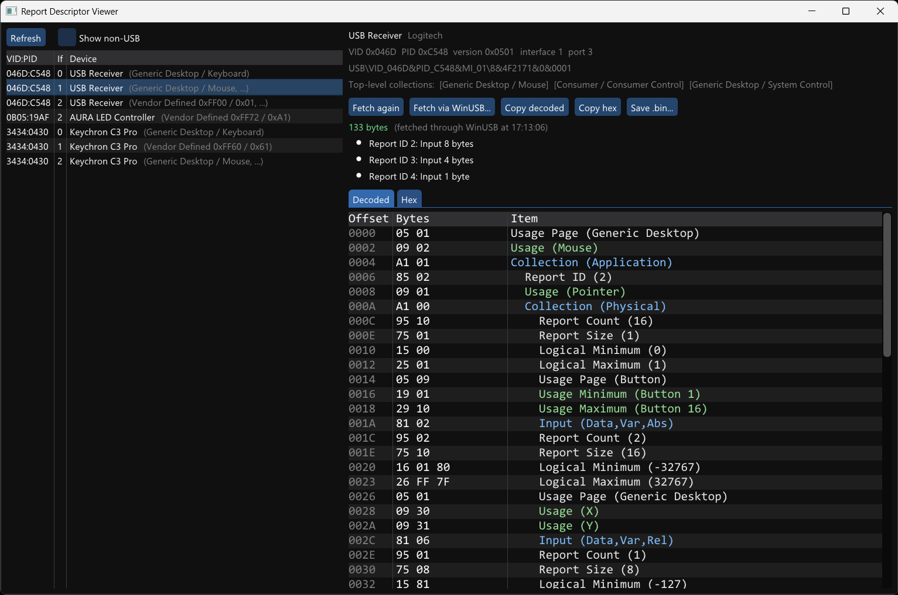

# Report Descriptor Viewer

This is a Windows application that lists connected HID devices and shows their HID report descriptors. It shows the actual descriptor as the device sends it, not one rebuilt from the parsed data that Windows keeps.

## Usage

- The list on the left shows HID interfaces. A USB interface with several top-level collections appears once, because they all share one report descriptor. Hover over a row to see all the collections. The list refreshes itself when devices are plugged in or removed.
- Click a device to fetch its report descriptor. **Fetch again** asks the device again.
- **Fetch via WinUSB...** is for devices that won't give up their descriptor the normal way (see below). It switches the interface to the WinUSB driver for a moment, asks for the descriptor, and puts the original driver back. It needs administrator rights, so you'll get a UAC prompt, and the device stops working for a few seconds, so don't use it on the only keyboard or mouse you have.
- **Decoded** shows the descriptor one item per row, indented by collection. **Hex** shows the raw bytes.
- Above the tabs is the size of each input, output and feature report.
- **Copy decoded** copies the descriptor as C source, with the decoded items as comments. **Copy hex** copies the plain bytes. **Save .bin...** writes the raw descriptor to a file.

## Limitations

The descriptor is requested from the device through the Windows USB hub driver (`IOCTL_USB_GET_DESCRIPTOR_FROM_NODE_CONNECTION`). No administrator rights or special drivers are needed. But the hub driver always sends the request with the *device* as the recipient, while HID report descriptors are meant to be requested from the *interface*. Many devices answer anyway. Others reject the request, and their descriptor can't be fetched this way.

For those there's **Fetch via WinUSB...**. It temporarily installs Windows' built-in WinUSB driver on the interface, which lets us send the request to the interface the proper way. Then it reinstalls the driver the interface had before. Before switching, it writes down which device it's changing in `%ProgramData%\report-descriptor-viewer\pending-restore.txt`. If the app is killed in the middle, it'll offer to restore the original driver the next time it starts (or run `rdv-dump --restore` as administrator).

The decoded descriptor's top-level collections are compared with the ones Windows reports for the interface, and you get a warning if they differ. A difference can mean the device ignored the interface number and sent another interface's descriptor.

Only USB devices are supported. Bluetooth, I2C and virtual HID devices are listed but can't be fetched.

## License and acknowledgements

The software in this repository is licensed under the [MIT License](LICENSE).

The UI uses [Dear ImGui](https://github.com/ocornut/imgui) (MIT).
